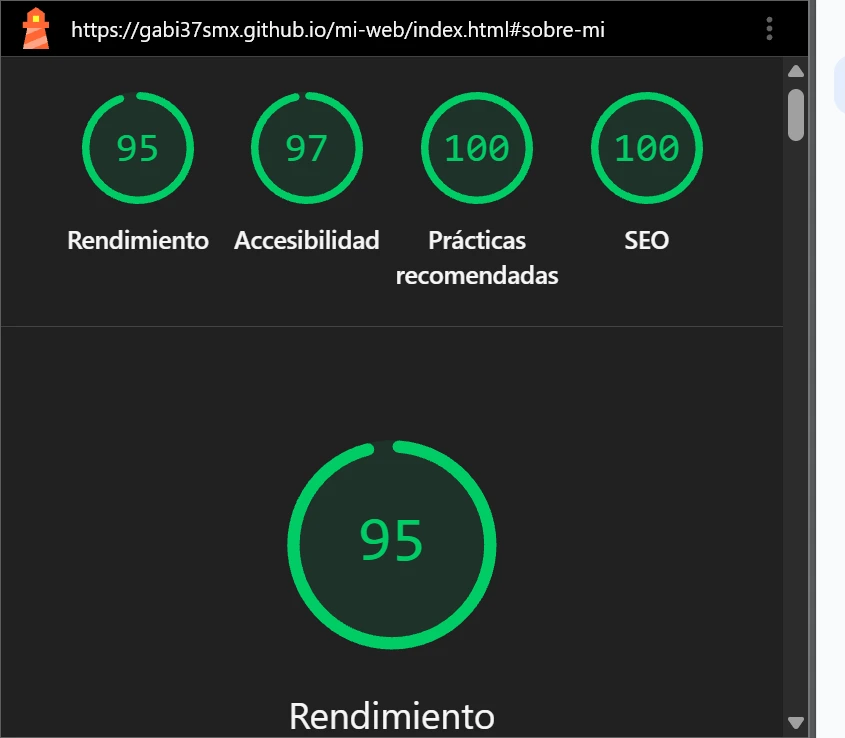

# 🧗 mi-web · Portfolio personal de Gabriel Vidal Badia

Web personal de marca con temática de escalada. Estudiante de 1º DAM en el IES Simarro (Xàtiva, Valencia), en transición desde el mantenimiento industrial hacia la programación, la IA y los agentes.

> *"Resolver problemas con el cuerpo, igual que con el código."*

🌐 **Web en directo:** https://gabi37smx.github.io/mi-web/
🔧 **Backend (repo separado):** https://github.com/gabi37smx/portfolio-backend

---

## 📖 ¿Qué es este proyecto?

Este repositorio contiene mi portfolio personal, construido desde cero como proyecto de la asignatura **Programación con IA** del ciclo de **Desarrollo de Aplicaciones Multiplataforma (DAM)**.

**No es una plantilla.** Es una web pensada, escrita y desplegada por mí, con:

- **Frontend en HTML, CSS y JavaScript puros** (sin frameworks, sin librerías externas).
- **Backend propio** en Node.js + Express, con base de datos MongoDB y envío de emails.
- **Despliegue real en producción:** GitHub Pages (frontend) y Render (backend).
- **Chatbot propio ("Cordada")** que responde por mí y tiene un plan B si la IA falla.
- **Página de noticias IA** que se actualiza a diario con titulares reales.
- **Juego "Vía al Cielo"**: plataformas con 17 pantallas (cuevas, grietas y 12 ciudades del mundo).
- **Vídeo demo** de 30 segundos con subtítulos.
- **4 skins visuales conmutables** (topo, omarchy, minecraft, matrix) y 3 idiomas (ES/VA/EN).

Todo el proceso está versionado con Git a lo largo de **más de 120 commits**, con mensajes honestos que cuentan las decisiones tomadas.

---

## 🗺️ Secciones de la web

| Sección | Contenido |
| --- | --- |
| Hero | Presentación + efecto máquina de escribir + efecto magnético en el título |
| Sobre mí | Retrato, biografía, terminal animada con bucle de aprendizaje, **vídeo demo con subtítulos** |
| Lo que he hecho | Formación, experiencia, timeline temática ("movimientos de la vía") |
| Proyectos | Casos de proyecto con formato problema → solución → resultado |
| Certificaciones | 2 títulos oficiales + 5 certificaciones Cisco Networking Academy |
| Me gusta | Montaña, escalada, tecnología, IA, música + widget del tiempo en directo + zonas de escalada + actividad de GitHub |
| Juego | **"Vía al Cielo"** (17 pantallas, 3 idiomas, récord en localStorage) |
| Contacto | Formulario real conectado a backend, panel de administración |
| Noticias IA | Titulares reales sobre IA de la última semana, vía backend propio (GNews) |

---

## 🎨 Identidad visual propia

Todo el sistema visual está hecho a mano, sin librerías externas:

- **Logo SVG inline** (`logo-svg` en el header): usa `currentColor` para adaptarse al tema claro/oscuro. Animación al hover con `prefers-reduced-motion` respetado.
- **Favicon SVG propio** (`favicon.svg`): el mismo símbolo, escalado a 16×16 píxeles.
- **4 iconos SVG de la misma familia** (trazo 2px, esquinas redondeadas) para las áreas de trabajo.
- **Cursor personalizado**: mano abierta/cerrada (topo/omarchy), espada de diamante (minecraft) o bloque de terminal (matrix). Se desactiva en móvil y con `prefers-reduced-motion`.
- **Barra lateral de escalada**: escalador SVG que sube por la vía conforme haces scroll.
- **Microinteracciones con intención**:
  - Aparición al scroll (marca el inicio de cada sección).
  - Hover de botones (indica "esto se pulsa").
  - Contador animado en las stats del hero (convierte un dato en un momento).
  - Todas respetan `prefers-reduced-motion`.

---

## 🎥 Vídeo demo · Así trabajo

En la sección "Sobre mí" hay un **vídeo de 30 segundos** donde le pido una mejora a la IA, la integro en mi web y compruebo el resultado en el navegador.

- **Peso final**: comprimido con HandBrake (H.264, CRF 28, Optimize for Web).
- **Póster**: `media/poster.webp`.
- **Atributos del `<video>`**: `controls`, `preload="none"`, `poster`, `playsinline`, `width`, `height`.
- **Accesibilidad**: incluye pista de subtítulos en español (`<track kind="captions" src="media/demo.vtt" srclang="es" label="Español" default>`).

Lo que enseña el vídeo: Le pido a la IA un mini-juego con requisitos concretos, me devuelve el código, lo integro, pruebo las mecánicas en el navegador y compruebo que funciona.

---

## 🎮 Juego "Vía al Cielo"

Un juego de plataformas vertical con temática de escalada que vive en la sección "Juego" del portfolio.

**Cómo funciona:**
- Sube por 17 pantallas distintas: 4 de cueva/grieta, 1 de aire libre y 12 ciudades del mundo (Valencia, Madrid, París, Londres, Nueva York, Roma, El Cairo, Tokio, Río, Sídney, Marrakech y Machu Picchu).
- Cada pantalla tiene 220 m de altura y fondos ilustrados (1080x1920) que se recorren al subir.
- Recoge los 3 fragmentos de código para recuperar vida.
- Animales propios de cada zona (murciélagos, osos, gallos, canguros, llamas...) que te quitan vida si te tocan.
- **Récord persistente** en `localStorage`.
- **Controles**: Teclado (flechas, A/D, W/Espacio para doble salto) y móvil (joystick táctil + botón de salto).
- **Rendimiento**: el motor del juego solo se ejecuta cuando la sección entra en pantalla (IntersectionObserver), ahorrando CPU.

**Fichero único**: `juego-escalada.js`. Sin librerías, sin red, todo dentro.

---

## 🤖 Chatbot "Cordada"

El chatbot Cordada es el asistente flotante que aparece en la esquina inferior derecha. Responde a los visitantes sobre mí, mis estudios, mis proyectos y cómo contactarme.

### Cómo funciona (arquitectura de dos capas)

- **Capa 1 · IA externa (cuando está disponible):** La pregunta viaja al backend, que la envía a una API de IA externa. La IA genera una respuesta natural basada en mis instrucciones.
- **Capa 2 · Árbol de decisión (plan B, siempre activo):** Si la IA falla (timeout, error HTTP, servicio caído), el chatbot responde con frases literales escritas por mí, organizadas en 9 temas: identidad, estudios, experiencia, proyectos, tecnologías, escalada, certificaciones, contacto e idiomas.

**Ventajas de este diseño:**
- **Resiliencia:** el chatbot no depende de ninguna API externa para funcionar.
- **Privacidad:** la conversación vive solo en el navegador del visitante.
- **Control:** el mensaje "no sé la respuesta" remite al contacto real.

---

## 🌐 APIs externas consumidas

El frontend consume directamente o a través del backend:

| API | Uso | Dónde se usa |
| --- | --- | --- |
| Open-Meteo | Tiempo actual + geocoding | Widget del tiempo (Me gusta) |
| OpenBeta (vía backend) | Zonas de escalada por ciudad | Widget del tiempo (Me gusta) |
| GitHub API (vía backend) | Actividad pública de repos | Sección "Me gusta" |
| Backend propio (vía /api/chat) | Proxy del chatbot Cordada | Chatbot flotante |
| Backend propio (vía /api/news/ai) | Proxy de GNews | Página "Noticias IA" |

---

## 🏗️ Decisiones de arquitectura (ADR)

Un ADR (Architecture Decision Record) es un documento breve que explica por qué se tomó una decisión técnica.

**ADR 1 · Frontend y backend en repositorios separados.**
- *Situación.* La web necesitaba tener un formulario real, pero debía publicarse como web estática en GitHub Pages.
- *Decisión.* Separar en dos repositorios: `mi-web` (estático, GitHub Pages) y `portfolio-backend` (Node.js, Render).
- *Consecuencia.* Cada parte se despliega de forma independiente. Evita subir código sensible al repo público. El coste es mantener dos repositorios coordinados.

**ADR 2 · Stack del backend: Node.js + Express + MongoDB + Resend.**
- *Situación.* Necesitaba un backend que recibiera mensajes, los guardara y me avisara por email.
- *Decisión.* Node.js + Express (estándar), MongoDB Atlas (esquema flexible, plan gratuito) y Resend (emails fáciles).
- *Consecuencia.* Tener un backend real en un portfolio me diferencia del 90 % de la clase. Limitación: Render duerme el servicio tras 15 min sin uso.

**ADR 3 · Sistema de traducción propio en lugar de librería externa.**
- *Situación.* Quería que la web estuviera disponible en tres idiomas (ES/VA/EN).
- *Decisión.* Escribir un sistema propio en `language.js` que recorre el DOM y traduce textos y atributos, guardando la selección en `localStorage`.
- *Consecuencia.* El sistema pesa solo ~40 KB y entiendo cómo funciona por dentro. El chatbot reutiliza este mismo patrón.

**ADR 4 · Chatbot con árbol de decisión como base, IA como capa opcional.**
- *Situación.* Las APIs gratuitas de IA son inestables. Dos servicios gratuitos dejaron de funcionar durante el desarrollo.
- *Decisión.* Diseñar el chatbot con dos capas independientes: capa IA (opcional) y árbol de decisión (base).
- *Consecuencia.* El chatbot funciona siempre, aunque la IA esté caída. En la defensa puedo explicar con datos reales que el árbol cubrió las caídas.

**ADR 5 · Widget de noticias IA con GNews tras descartar GDELT y Horizon.**
- *Situación.* Quería mostrar titulares reales de IA.
- *Decisión.* Usar GNews API con el plan de estudiante (1.000 peticiones/día). Caché de 30 minutos en el backend.
- *Consecuencia.* El widget muestra noticias reales, en español, actualizadas a diario. Si GNews falla, el fallback silencioso mantiene la web intacta.

**ADR 6 · Una sola imagen vertical por ciudad en el juego.**
- *Situación.* El motor del juego necesitaba fondos de ciudad que se recorrieran al subir.
- *Decisión.* Usar una única imagen vertical (1080x1920) recorrida de abajo a arriba, en lugar de dos imágenes con crossfade.
- *Consecuencia.* Menos peso (la mitad de peticiones por ciudad), menos código y menos fallos visuales. El navegador solo descarga la imagen cuando el jugador entra en esa pantalla.

**ADR 7 · El bucle del juego solo corre cuando es visible.**
- *Situación.* El `requestAnimationFrame` del juego consumía CPU incluso cuando el usuario estaba leyendo otras secciones.
- *Decisión.* Usar `IntersectionObserver` para arrancar el bucle solo cuando la sección `#juego` entra en el viewport, y pausarlo al salir.
- *Consecuencia.* Se elimina el bloqueo del hilo principal. En Lighthouse, el TBT bajó de 4830 ms a ~150 ms.

---

## 📊 Lighthouse final

Estado del portfolio en producción (gabi37smx.github.io/mi-web/):

| Categoría | Nota |
| --- | --- |
| Rendimiento | **98** |
| Accesibilidad | **97** |
| Prácticas recomendadas | **100** |
| SEO | **100** |

---

## 🚀 Cómo se publica

**Frontend → GitHub Pages**
- Rama publicada: `main`
- Carpeta: raíz (`/`)
- Fichero `.nojekyll`: en la raíz para desactivar el procesador Jekyll.
- URL final: https://gabi37smx.github.io/mi-web/

**Backend → Render**
- Servicio: `portfolio-backend` en https://render.com
- URL: https://portfolio-backend-m07q.onrender.com

---

## 🕰️ Historial de versiones

*El historial completo se puede consultar en la pestaña Commits del repositorio. Los mensajes siguen un esquema de versión semántica (vX.Y) y describen la decisión tomada.*

| Versión | Descripción |
| --- | --- |
| v1 | Primera web: estructura semántica básica |
| v2-v8 | Cursor personalizado, barra de escalada, formulario y foto personal |
| v13 | Backend online: formulario conectado a la API real |
| v15 | Selector de idiomas ES/VA/EN |
| v18 | Widget del tiempo en vivo (Open-Meteo) |
| v25 | Chatbot "Cordada" con backend propio y árbol de decisión |
| v26 | Página de noticias IA con proxy a GNews |
| v31 | Mini-juego "Vía de bloques" (Tetris) |
| v36 | Pulido de Lighthouse, README técnico, 4 skins completos |
| v73 | Juego "Vía al Cielo" con 17 pantallas (ciudades del mundo) |

---

## 👤 Autor

**Gabriel Vidal Badia**
- 🎓 1º DAM · IES Simarro (Xàtiva, Valencia)
- 🏅 Certificaciones Cisco: CCNA Intro, Ciberseguridad, Junior Cybersecurity Analyst Career Path
- 🎯 Enfoque: programación, inteligencia artificial y agentes
- 📫 Contacto: gabvidbad@alu.edu.gva.es
- 🐙 GitHub: @gabi37smx
- 💼 LinkedIn: gabriel-vidal-badia

## 📊 Lighthouse final

Estado del portfolio en producción (gabi37smx.github.io/mi-web/):

| Categoría | Nota |
| --- | --- |
| Rendimiento | **95** |
| Accesibilidad | **97** |
| Prácticas recomendadas | **100** |
| SEO | **100** |